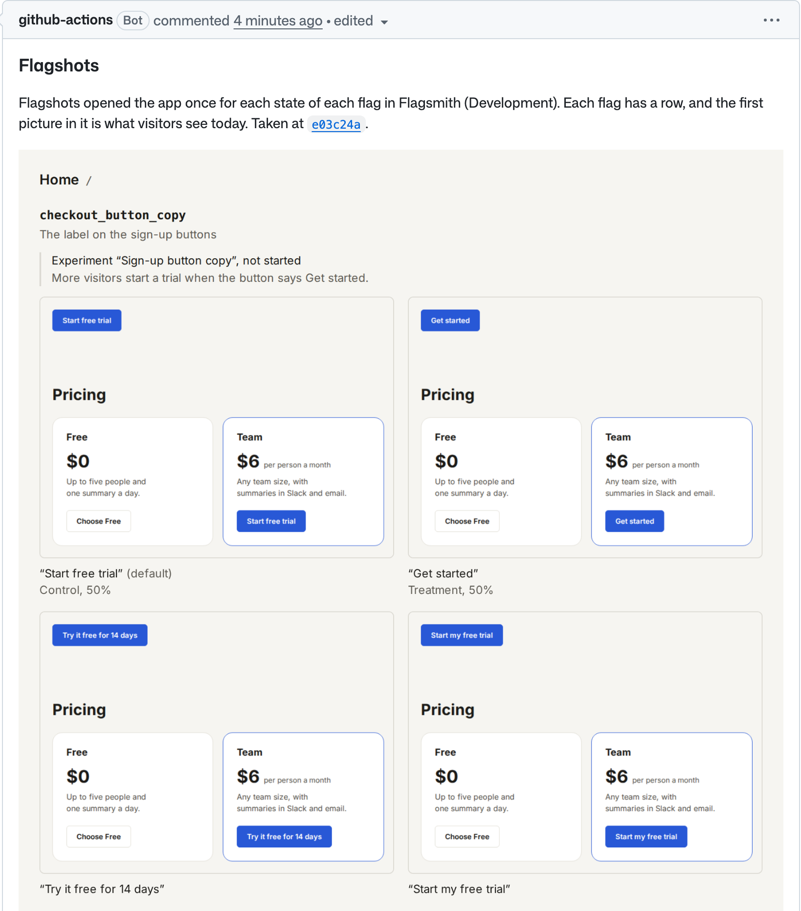

# Flagshots

Flagshots is a GitHub Action that screenshots your app in each state of each Flagsmith flag and posts the screenshots side by side on the pull request.



When a pull request changes a page behind a feature flag, the reviewer opens the preview and sees the version an ordinary visitor gets. Nobody looks at the off state, the other values of a multivariate flag or the treatment arm of an experiment before they reach production. Flagshots shows the reviewer each of those versions before the pull request is merged.

Flagsmith's GitHub integration links flags to pull requests and says whether each one is on. Flagshots adds what the page looks like in each state, and you can run the two together.

You can see it working on this repo's pull requests: https://github.com/CamDuncalfe/flagshots/pull/1 and https://github.com/CamDuncalfe/flagshots/pull/2.

## How it uses Flagsmith

Flagsmith decides what each screenshot shows. Flagshots sets real identity overrides and lets your Flagsmith evaluate them.

1. Flagshots reads the project's flags and each multivariate value from the Flagsmith Admin API, signed with an organisation Master API key. If you add a value in the Flagsmith dashboard, the next comment has a screenshot of it, with no change to your config.
2. For each state it creates an identity in Flagsmith, such as `flagshots-hero_layout-split`, and gives it an identity override for that one flag. It sets the overrides with the Flagsmith CLI:
   ```sh
   flagsmith flag update hero_layout --identifier flagshots-hero_layout-split --enable --value=split
   ```
3. Your app loads with `?flagshots_identity=flagshots-hero_layout-split` on the URL and passes that name to the Flagsmith SDK as the identity. Flagsmith answers with `hero_layout` set to `split` and every other flag at its normal value.
4. Before it takes any screenshot, Flagshots asks Flagsmith for each identity's flags the way your app will, with the client-side key, and stops the run if any flag is wrong.
5. When a flag is in a Flagsmith experiment, Flagshots reads the experiment from the API. Its row in the grid shows the experiment's name, status and hypothesis, and the captions say which shot is control and which is treatment, with each one's share of visitors. Flagsmith puts identities into an experiment's buckets even before it starts, so Flagshots also gives each identity an override that holds the experiment's flag at the control value in the other rows.

The identities and overrides are the only things Flagshots writes. It leaves your environment's own flag settings alone, and real visitors see nothing different.

Flagsmith can run inside the CI job. The action starts Flagsmith 2.294.0 and Postgres with `docker compose` on the runner, creates the flags from a seed file in your repo, and throws the whole thing away when the job ends. You don't need a Flagsmith account for that. If you run Flagsmith yourself, you can point the action at it instead.

## Quick start

### 1. Pass the identity to Flagsmith in your app

Flagshots loads each page with `?flagshots_identity=<name>`. Your app reads it and hands it to the Flagsmith SDK. With the JavaScript SDK that's three lines:

```js
const identity = new URLSearchParams(window.location.search).get('flagshots_identity');

await flagsmith.init({
  environmentID: import.meta.env.VITE_FLAGSMITH_ENVIRONMENT_KEY,
  api: import.meta.env.VITE_FLAGSMITH_API_URL,
  identity: identity ?? undefined,
  cacheFlags: false,
});
```

Without the parameter your app loads the way it always does. If your flags are evaluated on a server, pass the identifier to your server-side SDK in the same way.

When the page has drawn with its flags, set an attribute Flagshots can wait for, such as `document.documentElement.dataset.flagsReady = 'true'`, and name it in `readySelector` (step 2). Without it Flagshots waits for the network to go quiet, which can be before the flags arrive.

### 2. Add `flagshots.config.json`

```json
{
  "baseUrl": "http://localhost:5173",
  "pages": [{ "name": "Home", "path": "/" }],
  "readySelector": "html[data-flags-ready]",
  "viewport": { "width": 1280, "height": 800 }
}
```

| Key | What it does | Default |
| --- | --- | --- |
| `baseUrl` | Where your app is served during the job | `http://localhost:5173` |
| `pages` | The pages to screenshot, each with a `name` and a `path`. Flagshots makes one grid image per page. | `[{ "name": "Home", "path": "/" }]` |
| `readySelector` | A selector that matches once the page has drawn with its flags | none: Flagshots waits for the network to go quiet |
| `identityParam` | The URL parameter that carries the identity | `flagshots_identity` |
| `viewport` | The browser window size | `{ "width": 1280, "height": 800 }` |
| `flags` | Only screenshot these flags | every flag in the environment |
| `timeoutMs` | How long one page may take to load | `15000` |
| `waitSeconds` | How long to wait for Flagsmith and the app to start | `120` |

### 3. Add `flagshots.seed.json`

The action creates these flags in the Flagsmith it runs inside the job. Copy the flags your app uses, with the value visitors get first and the other values under `variants`:

```json
{
  "organisation": "My company",
  "project": "My app",
  "environment": "Development",
  "features": [
    {
      "name": "hero_layout",
      "type": "MULTIVARIATE",
      "enabled": true,
      "value": "classic",
      "variants": ["split", "banner"]
    },
    { "name": "dark_mode", "type": "STANDARD", "enabled": false }
  ],
  "experiments": [
    {
      "name": "Hero layout test",
      "flag": "hero_layout",
      "hypothesis": "More visitors scroll to pricing with the split hero.",
      "split": { "split": 50 }
    }
  ]
}
```

`experiments` is optional. The action creates each experiment without starting it, and `split` gives a value its percentage of visitors (control gets the rest).

### 4. Add the workflow

`.github/workflows/flagshots.yml`:

```yaml
name: Flagshots
on: pull_request

permissions:
  contents: write # the flagshots-images branch, where the grid images are kept
  pull-requests: write # the comment

jobs:
  flagshots:
    runs-on: ubuntu-latest
    steps:
      - uses: actions/checkout@v7
      - uses: CamDuncalfe/flagshots@v1
        with:
          start-command: >-
            npm ci &&
            VITE_FLAGSMITH_API_URL="$FLAGSMITH_API_URL/"
            VITE_FLAGSMITH_ENVIRONMENT_KEY="$FLAGSMITH_ENVIRONMENT_KEY"
            npm run build && npm run preview -- --port 5173
```

`start-command` builds and serves your app on the address in `baseUrl`. The action runs it once Flagsmith is ready, with `FLAGSMITH_API_URL` and `FLAGSMITH_ENVIRONMENT_KEY` set, and waits for `baseUrl` to answer. Most front ends read the environment key at build time, so build the app in this command, after Flagsmith has made the key.

On the next pull request the action posts one comment and edits that same comment on every push. A run takes about two minutes on `ubuntu-latest`.

### Action inputs

| Input | What it does | Default |
| --- | --- | --- |
| `start-command` | Builds and serves your app (required) | |
| `config` | Path to the config file | `flagshots.config.json` |
| `seed-file` | The flags to create in the Flagsmith inside the job | `flagshots.seed.json` |
| `flagsmith-api-url` | Your own Flagsmith's API root, such as `https://flagsmith.example.com/api/v1`. Leave it empty to run Flagsmith inside the job. | empty |
| `environment-key` | The client-side key of the environment to screenshot, with `flagsmith-api-url` | empty |
| `admin-api-key` | An organisation Master API key (Organisation settings, API Keys), with `flagsmith-api-url`. Keep it in a repository secret. | empty |
| `flags` | Comma-separated flag names to screenshot | every flag |
| `github-token` | The token for the image branch and the comment | `github.token` |

To use your own Flagsmith, set the three Flagsmith inputs and leave out the seed file:

```yaml
      - uses: CamDuncalfe/flagshots@v1
        with:
          start-command: npm ci && npm run build && npm run preview -- --port 5173
          flagsmith-api-url: https://flagsmith.example.com/api/v1
          environment-key: ${{ vars.FLAGSMITH_ENVIRONMENT_KEY }}
          admin-api-key: ${{ secrets.FLAGSMITH_ADMIN_API_KEY }}
```

Point it at a development or preview environment. Flagshots leaves its identities, named `flagshots-...`, in that environment after the job, and you can delete them on the Identities page.

## Run Flagsmith and Flagshots on your machine

You need Node 20.12 or later, Docker and the [Flagsmith CLI](https://github.com/Flagsmith/flagsmith-cli/releases). If the CLI isn't on your `PATH`, set `FLAGSHOTS_FLAGSMITH_CLI` to where it is.

```sh
npm ci
npx playwright install chromium
npm --prefix demo ci

docker compose up -d      # Postgres and Flagsmith 2.294.0 on http://localhost:8000
npm run seed              # the demo project, its four flags and one experiment
npm run demo:build
npm run demo:preview      # in a second terminal: the demo on http://localhost:5173
npm run shots             # writes the grid to .flagshots/home.png
```

`npm run seed` signs up a local admin on the fresh Flagsmith (`admin@flagshots.example`, password `local-flagshots-admin-2026`, both set in `scripts/seed.js`), creates the organisation, project, environment, flags and experiment, and makes a Master API key. It writes the keys to `.env.local` and `demo/.env.local`, which git ignores. You can run it again at any time: it reuses what's there and puts each flag back to the seed's on or off.

Sign in to the dashboard at http://localhost:8000 with the admin account to change flags, add a value or start the experiment, then run `npm run shots` again. `docker compose down -v` deletes the database.

## The demo app

`demo/` holds Kettle, a one-page site for a made-up standup tool, built with Vite and the Flagsmith JavaScript SDK. It has four flags:

- `hero_layout` is multivariate. Its value, `classic`, `split` or `banner`, picks the layout of the top of the page.
- `checkout_button_copy` is multivariate and holds the sign-up button label. It's in the experiment "Sign-up button copy", which isn't started.
- `pricing_badge` turns a New badge on the Team plan on and off.
- `dark_mode` turns the dark colour scheme on and off.

This repo's workflow runs the action against Kettle on each pull request. Pull request 1 changes the plan cards to a warmer white. Its first comment showed light text on near-white cards with `dark_mode` on, and I fixed that in the second push. Pull request 2 adds a fourth button label in the seed file, and the comment shows it with no other change.

## What's in the repo

- `action.yml` is the action. It installs Flagshots and Chromium, starts Flagsmith from `docker-compose.yml`, runs `scripts/seed.js`, installs the Flagsmith CLI with `Flagsmith/setup-cli`, starts your app, runs `src/cli.js` and then `src/publish.js`.
- `src/flagsmith-admin.js` makes the Admin API and client API calls. `src/flagsmith-cli.js` runs the Flagsmith CLI for the overrides.
- `src/plan.js` works out the states to screenshot, one per value, and labels experiment arms. `npm test` covers it with no network.
- `src/overrides.js` sets the identity overrides and checks them. `src/render.js` takes the screenshots with Playwright, each in a fresh browser context.
- `src/grid.js` lays out the grid image. It compares each screenshot with the default one, crops a row to the part of the page that changed, and shows whole pages when most of the page changed.
- `src/comment.js` writes the comment, and `src/publish.js` commits the images to the `flagshots-images` branch and posts or edits the comment.

GitHub's API can't attach an image to a comment, so the job commits each grid to an orphan branch called `flagshots-images` and links it from the comment. The links name the image's commit, so an edited comment never shows an old image from a cache.

## Limits

- A pull request from a fork gets a read-only token, so Flagshots can't comment on it or push images. The grids go to the job summary and the run's `flagshots` files instead.
- Your app needs the identity hook from step 1. A page that can't take an identifier can't be screenshotted yet.
- Each screenshot changes one flag. Flagshots doesn't render combinations of flags.
- It screenshots every flag in the environment unless you list some in `flags`. It doesn't yet pick out only the flags a pull request touches.
- A flag that's on with no value can't be held at that state with the CLI. If that ever happens, the check before the screenshots stops the run.
- I built and tested Flagshots against Flagsmith 2.294.0, the version in `docker-compose.yml`.

I haven't tested these yet: the action against your own Flagsmith with `flagsmith-api-url` (only the Flagsmith inside the job has run in CI so far), the action against flagsmith.com, and image links in the comment on a private repo.

## Licence

MIT, see [LICENSE](LICENSE). The demo and the grid use the Inter typeface, under the SIL Open Font License.
